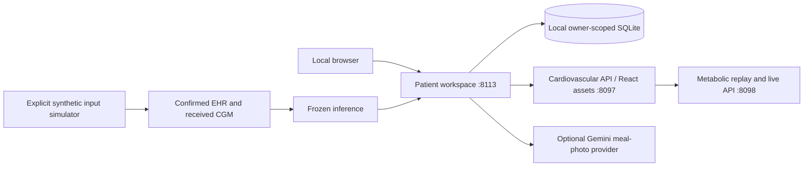

# Runtime architecture

The patient shell (`patient_experience`) exposes onboarding, confirmed EHR facts, connected observations, live monitoring, meal review, readiness, persisted predictions, evidence, and alerts. Its inheritance chain preserves the existing patient-domain and feature APIs. SQLite storage remains owner-scoped; patient creation starts a new identity instead of selecting a research-cohort participant.

The React frontend contains the historical Cardiovascular and Metabolic Twin dashboards, with one shared wearable component. Its built wearable entry is also mounted into the newer patient shell. Generated heart/flow illustrations are product assets, not patient images.

## Scientific boundaries

Short-horizon glucose forecasting uses the frozen D2 model at +30, +60, +90 and +120 minutes. Its population and personalized models remain distinct. The personal expected trajectory is computed from eligible historical observations; predicted-versus-expected divergence is descriptive and is not a probability.

A separate multimodal model estimates the existing two-hour spike event. Its seven clinical fields plus 26 dynamic fields must not be confused with the forecaster's 21 core plus 12 personal-history inputs. Wearables and meal annotations remain contextual for the frozen feature vectors; meal logging does not directly modify trained model parameters. The simulator can use confirmed synthetic meals to generate a future observation path, which is then processed through the unchanged inference pipeline.

The Cardiovascular screen is the preserved synthetic research replay. The new-patient workflow is metabolic; this release does not claim a generalized cardiovascular predictor for arbitrary new patients.

## Deployment verification

`src/runtime_assets.py` defines the closed asset list, enforces hashes and forecast-role identity, and checks scientific source/config fingerprints. Only an explicitly configured deployment manifest selects this path. It avoids reading raw datasets just to serve predictions. The original research verification and evaluation code remains present and selected outside deployment mode.

`tools/runtime_bundle.py` transports required private assets without copying the research workspace. The GitHub exporter copies code/config/UI files through an independent allowlist, checks credential patterns, and excludes model/data artifacts. Neither pipeline retrains models, changes event definitions, modifies patient clocks, or runs the sealed holdout evaluation.

Native devices are not paired by this prototype. Simulated CGM and wearable feeds are labelled as such. Gemini image analysis is optional and uses an explicit model ID; proposed nutrition estimates require human confirmation. Patient identifiers and clinical records are not included in that vision request, but selected image pixels are sent to the configured provider.
